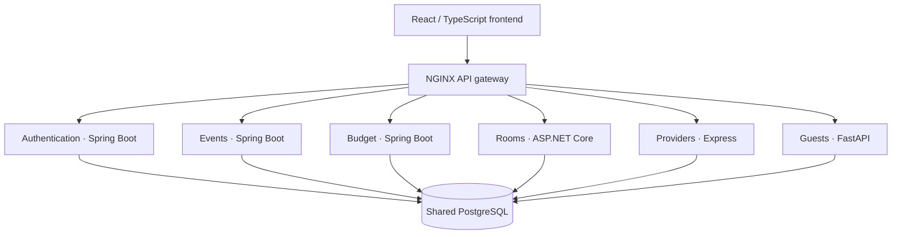

# EventFlow

**Event management, from planning and reservations to invitations and financial tracking.**

EventFlow is a web application built around six REST microservices, a shared React interface and an NGINX API gateway. It brings together event scheduling, room bookings, provider assignments, guest management and budgets, with coordinated checks between services.

Developed by **Team 20** for the **Services Web** module of the **Master Ingénierie Logicielle**, Université Ibn Zohr — Faculté des Sciences d’Agadir, academic year **2026–2027**, supervised by **Pr. Jaafar Idrais**.

## Features

- **Events:** create and update events, search and paginate listings, and manage their lifecycle.
- **Budgets and expenses:** allocate one budget per event, track planned, committed and paid amounts, manage expense statuses, and close or reopen budgets.
- **Rooms and reservations:** manage rooms, check booking dates and availability, and submit reservation costs for budget approval.
- **Providers:** maintain a provider directory and service catalogue, assign contracts to events, and synchronize their financial commitments.
- **Guests and invitations:** manage contacts and event associations, track invitation responses, and check attendance against approved room capacity.
- **Authentication:** sign in through a dedicated service and access protected APIs using JWTs.

The interface includes event details, budget summaries, expense breakdowns and the management screens for each domain.

## Architecture



The frontend uses the gateway as its API entry point. Services communicate synchronously over HTTP/JSON for cross-domain operations. PostgreSQL is shared physically; each service manages its domain tables, while cross-service validation and financial operations use the relevant service APIs.

### Components

| Component | Technology | Local port | Gateway API prefix |
| --- | --- | ---: | --- |
| Frontend | React 19, TypeScript, Vite | 5173 | — |
| API gateway | NGINX | 8081 | `/api/*` |
| Authentication | Java 21, Spring Boot 3.5 | 5005 | `/api/auth` |
| Events | Java 21, Spring Boot 3.5 | 5001 | `/api/evenements` |
| Budget | Java 21, Spring Boot 3.5 | 5004 | `/api/budgets`, `/api/depenses` |
| Rooms and reservations | ASP.NET Core 10, Entity Framework Core | 5242 | `/api/salles`, `/api/reservations` |
| Providers | Node.js, Express 4 | 5002 | `/api/prestataires`, `/api/contrats-prestataire` |
| Guests and invitations | Python 3.12, FastAPI, SQLAlchemy | 5003 | `/api/v1` |
| Database | PostgreSQL 18 | 5433 | Not exposed through the gateway |

These are development ports. In the production Compose stack, backend and database ports are not published to the host.

### Coordinated business rules

Room reservations and provider contracts submit their costs to Budget. Budget validates the event through the Events API, checks the available allocation and maintains linked expenses. Updates replace an existing commitment rather than adding the same charge again. Cancelled commitments release funds; completing a service does not automatically mark its expense as paid.

Overspending is configurable per budget. When disabled, a proposed commitment must fit the remaining allocation. A budget must be open to accept changes. Linked expenses are managed through their source reservation or contract rather than edited independently.

Guest capacity comes from distinct rooms with active, budget-approved reservations. Guest registration and capacity-reducing room changes coordinate through the relevant services. Interrupted financial requests retain explicit synchronization states and can be retried; there is no distributed transaction spanning the services.

## Run locally

### Prerequisites

- Linux or a compatible Bash environment.
- Docker Engine and Docker Compose v2, with permission to run Docker commands.
- JDK **21** and Maven.
- Node.js **22.12 or later** and npm; Node.js 22 is recommended.
- .NET SDK **10**.
- `curl` and an Internet connection for initial dependencies and images.

Python runs inside the Invités container for the standard local startup; a host Python installation is only needed for standalone Python development and tests.

### Start the application

```bash
git clone https://github.com/ysn133/event-management-system.git
cd event-management-system

npx --yes pnpm@10 --dir frontend install --frozen-lockfile
bash scripts/run-local.sh
```

Open **http://localhost:5173**. The API gateway is available at **http://localhost:8081**.

The launcher starts PostgreSQL, applies database migrations, loads repeatable demo data, prepares local integration secrets and starts all six services, the gateway and the frontend. PostgreSQL, Invités and NGINX run in Docker; the remaining backends and frontend run on the host. Missing provider dependencies are installed automatically.

The default JDK location is `/usr/lib/jvm/java-21-openjdk-amd64`. If Java 21 is installed elsewhere:

```bash
EVENTFLOW_JAVA_HOME=/path/to/jdk-21 bash scripts/run-local.sh
```

The launcher selects that JDK without changing the system-wide Java installation. It also uses `npx node@20` for its frontend process, so its first invocation can require an additional download.

### Development login

| Field | Local default |
| --- | --- |
| Email | `admin@eventflow.local` |
| Password | `EventFlow-dev-2026!` |

These are **development-only defaults**, not production credentials. Set `BOOTSTRAP_USER_EMAIL` and `BOOTSTRAP_USER_PASSWORD` before startup to choose another initial account. Bootstrap creates an account only if its email does not already exist; restarting with another password does not reset an existing account.

### Demo data and persistence

Demo data is loaded by default. To keep the launcher from refreshing it:

```bash
LOAD_DEMO_DATA=false bash scripts/run-local.sh
```

To load the demo fixtures again independently:

```bash
bash scripts/seed-demo.sh
```

Development database files persist under `database/data/`. Stopping the application does not remove them. The database schema, connection formats and migration details are described in [database/README.md](database/README.md).

Press **Ctrl+C** in the launcher's terminal to stop its application processes and the containers it started. PostgreSQL remains running. The launcher prints the location of its temporary service logs.

## Authentication and configuration

Protected requests use `Authorization: Bearer <token>`. The gateway routes requests and forwards authorization; authentication is enforced by the services, not replaced by the proxy. Dedicated financial integration endpoints additionally require server-side service keys, which are not supplied by the browser.

Local signing and integration keys are generated under the ignored `.local/` directory. Application login accounts are separate from event organizers in the business model.

| Configuration | Purpose |
| --- | --- |
| `EVENTFLOW_JAVA_HOME` | Java 21 location for the local launcher |
| `GATEWAY_PORT` | Gateway host port; defaults to `8081` locally |
| `JWT_SECRET`, `JWT_ISSUER` | Token signing and issuer configuration shared by the services |
| `BOOTSTRAP_USER_EMAIL`, `BOOTSTRAP_USER_PASSWORD` | Initial authentication account |
| `CONTRACT_SERVICE_KEY`, `ROOM_BUDGET_SERVICE_KEY` | Additional credentials for financial service-to-service calls |
| `LOAD_DEMO_DATA` | Whether the local launcher refreshes demo fixtures |

See [API authentication](docs/API_AUTHENTICATION.md) and the service-specific configuration examples. A `.env.example` file is a template, not a universal configuration loader: the local launcher reads exported shell variables, while Compose reads its environment file.

There is no public registration endpoint or fine-grained role/organizer ownership model. Invitation delivery is simulated locally and disabled in the production Compose configuration; external email or SMS delivery is not configured by default.

## Tests and quality checks

Run commands from the repository root unless a working directory is specified.

```bash
# Select JDK 21 for this terminal; adjust the path if needed
export JAVA_HOME="${EVENTFLOW_JAVA_HOME:-/usr/lib/jvm/java-21-openjdk-amd64}"
export PATH="$JAVA_HOME/bin:$PATH"

# Java services: JUnit, Mockito and local Spring integration tests
mvn -f quality/java/pom.xml verify

# Java coverage and static-analysis reports
mvn -f quality/java/pom.xml -Pquality verify
mvn -f quality/java/pom.xml -Pquality -DskipTests checkstyle:checkstyle

# Providers
npm --prefix services/prestataires ci
npm --prefix services/prestataires test

# Rooms and reservations
dotnet test services/salles/GestionSalles.Tests/GestionSalles.Tests.csproj

# Gateway routing and authentication: requires the normal application running
node gateway/test-gateway.mjs
```

Use JDK 21 for the Maven commands. JaCoCo reports are generated under each Java service's `target/site/jacoco/`; Checkstyle reports are under `target/site/`. Checkstyle warnings are informational, not a clean-style guarantee.

For the gateway smoke test, custom login credentials require `TEST_AUTH_EMAIL` and `TEST_AUTH_PASSWORD`; a custom gateway address requires `GATEWAY_URL`. The test does not automatically read the launcher's bootstrap credentials or `GATEWAY_PORT`.

For guest unit tests, use a Python 3.12 virtual environment:

```bash
cd services/module_invites
python3.12 -m venv .venv
.venv/bin/pip install -r requirements.txt
.venv/bin/python -m pytest app/tests/unit
```

The tooling in [`quality/java/`](quality/java/) also supports an isolated PostgreSQL test environment, a Newman API collection, Selenium journeys, JMeter load scenarios and a bounded authenticated ZAP passive scan. Its non-Java domains use explicit test doubles; it does not validate the complete six-service deployment. Runtime secrets, generated reports, screenshots and scan outputs are excluded from Git.

Dependency and passive-security analyses have reported findings. Their execution must not be interpreted as a vulnerability-free result; dependency upgrades and configuration remediation require a separate review and regression run.

## Deploy on a VPS

Production uses the standalone [`compose.production.yaml`](compose.production.yaml). It builds all six microservices and the frontend; the compiled frontend is served by the NGINX gateway. Only the gateway is published, on **`127.0.0.1:43871`** by default, for an existing host reverse proxy to reach.

On the VPS, clone the repository and create the private configuration file without overwriting an existing one:

```bash
cp -n deploy/production.env.example .env.production
```

Set `PUBLIC_ORIGIN`, the database settings, initial login credentials and independent secrets in `.env.production`. The initial password must contain at least 12 characters and at most 72 UTF-8 bytes. Generate each secret separately, for example with `openssl rand -hex 32`. Never reuse development credentials or commit this file.

Then deploy:

```bash
bash scripts/deploy-production.sh
```

The deployment script builds images, backs up an existing initialized database, stops application writers, runs migrations and waits for the stack to become healthy. Reuse the script for subsequent deployments; its migration phase causes a brief application interruption.

Configure a dedicated host NGINX virtual host using [`deploy/nginx-site.conf.example`](deploy/nginx-site.conf.example), pointing at the configured loopback port. Enable HTTPS before exposing login publicly. Do not replace unrelated sites on the VPS, combine the development and production Compose files, or delete the production database volume.

## Repository layout

```text
frontend/                  React application
gateway/                   Development gateway routes and smoke tests
services/
  auth-service/            Authentication and JWT issuance
  evenement-service/       Event management
  budget-service/          Budgets, expenses and financial integration
  salles/                  Rooms and reservations
  prestataires/            Provider directory, services and contracts
  module_invites/          Guests, invitations and capacity checks
database/                  Initial schema, migrations and demo fixtures
deploy/                    Production Dockerfiles and reverse-proxy configuration
scripts/                   Local startup, deployment and data-transfer utilities
quality/java/              Reusable Java quality and integration-test tooling
docs/                      API contracts and integration documentation
```

Useful integration references: [room budget approval](docs/ROOM_BUDGET_APPROVAL.md), [provider commitments](docs/PROVIDER_CONTRACT_BUDGET.md), and [guest capacity](docs/GUEST_ROOM_CAPACITY.md). REST contracts are available in [`docs/api-contracts/`](docs/api-contracts/) and [`docs/api/`](docs/api/).

## Team

| Member | Main responsibility |
| --- | --- |
| Yassine Chouikh | Budget, Events and Authentication; gateway, database setup, deployment and test coordination |
| Othman El Allaoui | Rooms and reservations |
| Hamza Kaissouni | Providers and service catalogue |
| Abdessadek Tagarte | Guests and invitations |

The shared frontend and cross-service workflows bring together the team's modules and integration work.
